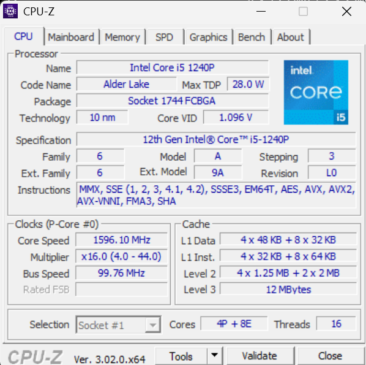
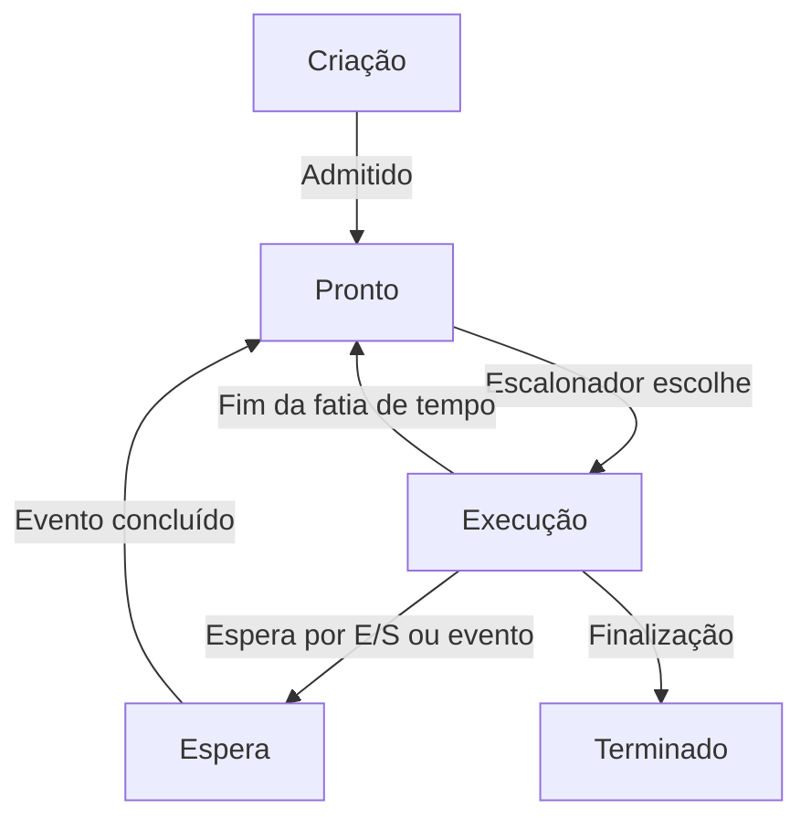
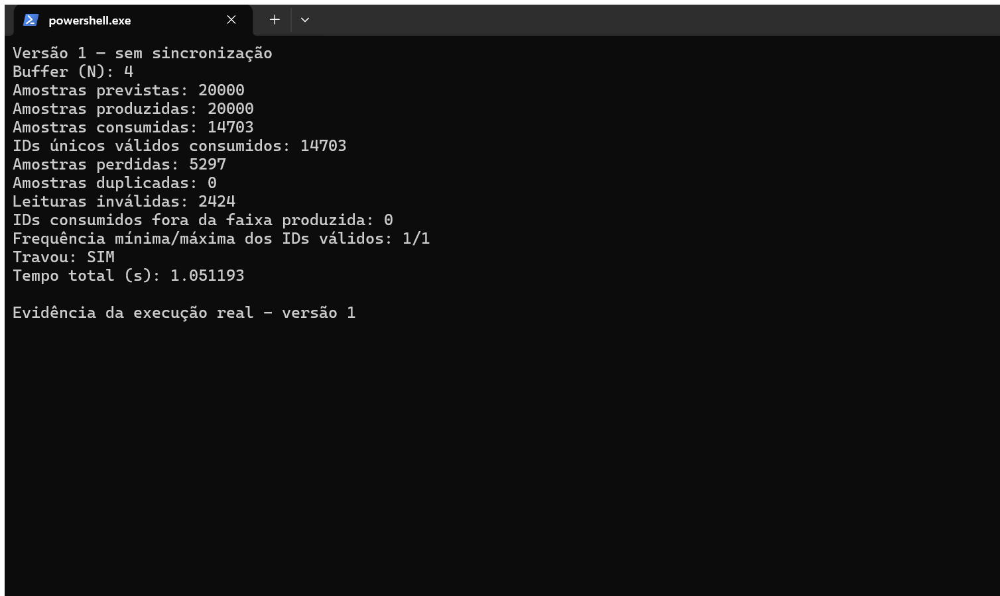
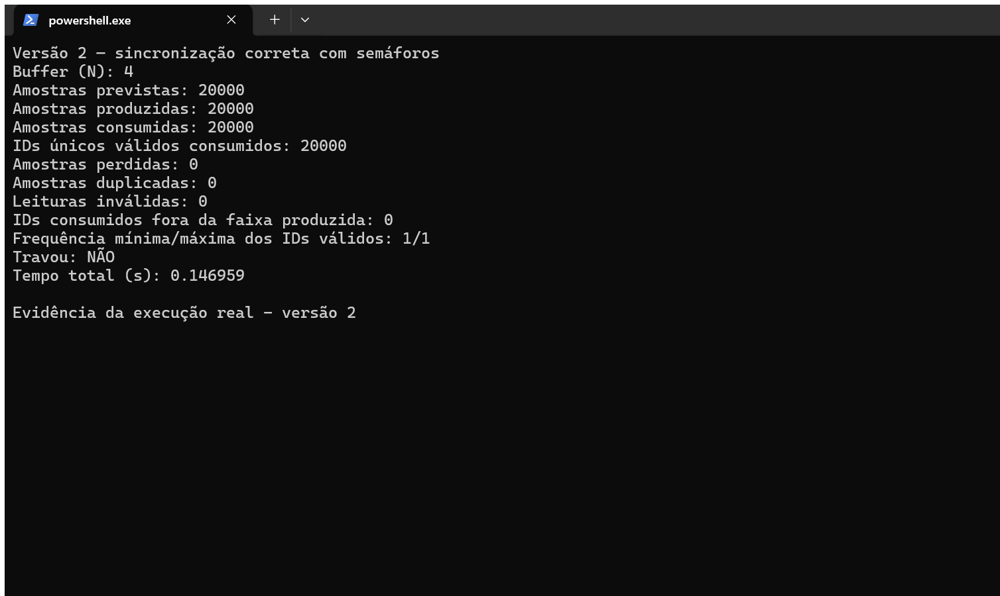
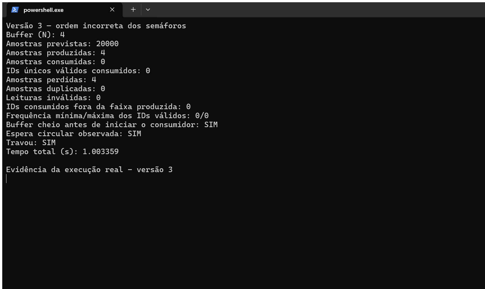
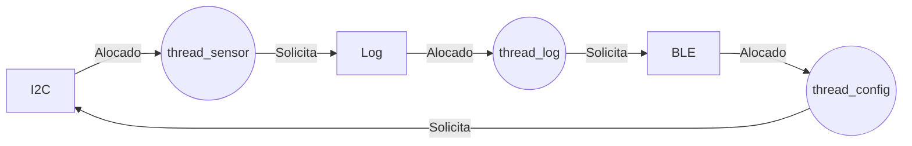

Nome completo: Bruno Gabriel Giordano Guilherme Kadayan | D1: 2 | D2: 6 | N: 4

# Ponderada CC08: Do Pipeline ao Deadlock

(considerando Bruno Gabriel como primeiro nome)


## Parte A: Problema Técnico

### A1: Arquitetura e Memória

#### 1. Plataforma H

**Dados:**
- IC = 220.000 instruções
- CPI = 1,5 ciclos por instrução
- Clock = 48 MHz = 48.000.000 Hz

A fórmula é:

$$
T = \frac{IC \times CPI}{f}
$$

Substituindo os valores:

$$
T = \frac{220.000 \times 1,5}{48.000.000}
$$

$$
T = \frac{330.000}{48.000.000} = 0,006875 \text{ s}
$$

Deixando em ms:

$$
T = 0,006875 \times 1000 = 6,875 \text{ ms}
$$

**Conclusão:**

A Plataforma H não atende ao requisito de 5 ms, pois leva 6,875 ms para processar cada amostra, passando o limite em 1,875 ms.


#### 2. Plataforma V

**Dados:**
- IC = 220.000 instruções
- Clock = 1,2 GHz = 1.200.000.000 Hz
- CPI base = 1,0
- Acessos à memória por instrução = 1,3
- Tempo de acerto na cache L1 = 1 ciclo
- Penalidade de falta = 120 ciclos
- Atraso máximo do Linux = 3 ms

**Taxa de falta na cache (m):**

A taxa de falta depende de D1:

$$
m = 3\% + (0,5\% \times D1)
$$

Trocando D1 = 2:

$$
m = 3\% + (0,5\% \times 2) = 4\%
$$

A taxa de falta fica em 4%.

**Tempo médio de acesso à memória (AMAT):**

A fórmula é:

$$
AMAT = \text{Tempo de acerto} + (m \times \text{Penalidade})
$$

Trocando os valores:

$$
AMAT = 1 + (0,04 \times 120)
$$

$$
AMAT = 1 + 4,8 = 5,8 \text{ ciclos}
$$

**CPI efetivo:**

O CPI efetivo considera os ciclos adicionais de espera causados pelas faltas na cache.

A fórmula é:

$$
CPI_{efetivo} = 1,0 + (Acessos \times m \times Penalidade)
$$

Trocando os valores:

$$
CPI_{efetivo} = 1,0 + (1,3 \times 0,04 \times 120)
$$

$$
CPI_{efetivo} = 1,0 + 6,24 = 7,24
$$

Entrão, considerando as faltas na cache a Plataforma V tem um CPI efetivo de 7,24 ciclos por instrução.

**Tempo de processamento:**

Utilizando o CPI efetivo, podemos calcular o tempo de processamento da Plataforma V:

$$
T = \frac{IC \times CPI_{efetivo}}{f}
$$

Trocando os valores:

$$
T = \frac{220.000 \times 7,24}{1.200.000.000}
$$

$$
T = \frac{1.592.800}{1.200.000.000}
$$

$$
T \approx 0,0013273 \text{ s}
$$

Convertendo para ms:

$$
T \approx 0,0013273 \times 1000 = 1,3273 \text{ ms}
$$

**Pior caso com atraso do Linux:**

O Linux pode interromper a tarefa, causando um atraso adicional de até 3 ms. Somando esse atraso ao tempo calculado:

$$
T_{pior} = T + 3 \text{ ms}
$$

$$
T_{pior} = 1,3273 + 3 = 4,3273 \text{ ms}
$$

**Conclusão:**

A Plataforma V atende ao requisito de 5 ms, pois apresenta um tempo de processamento de aproximadamente 1,327 ms. Mesmo considerando o atraso máximo de 3 ms do Linux, o tempo calculado chega a 4,327 ms, permanecendo cerca de 0,673 ms abaixo do limite estabelecido.

#### 3. Acelerador DSP

**Dados:**
- Tempo original da Plataforma H = 6,875 ms
- Parte do processamento correspondente ao filtro = 60%
- Aceleração do filtro com DSP = 5 vezes

**Cálculo do speedup global:**

Para calcular o ganho de desempenho com o DSP, utilizamos a Lei de Amdahl:

$$
Speedup = \frac{1}{(1-F)+\frac{F}{S}}
$$

Onde:
- F = fração do processamento que será acelerada (0,6)
- S = fator de aceleração dessa parte (5)

Substituindo os valores:

$$
Speedup = \frac{1}{(1-0,6)+\frac{0,6}{5}}
$$

$$
Speedup = \frac{1}{0,4+0,12}
$$

$$
Speedup = \frac{1}{0,52} \approx 1,923
$$

Portanto, o DSP torna o processamento total aproximadamente 1,92 vez mais rápido.

**Novo tempo de processamento:**

Para calcular o novo tempo, dividimos o tempo original pelo speedup:

$$
T_{novo} = \frac{T_{original}}{Speedup}
$$

Trocando os valores:

$$
T_{novo} = \frac{6,875}{1,9230769}
$$

$$
T_{novo} = 3,575 \text{ ms}
$$

**Conclusão:**

Com o acelerador DSP, a Plataforma H passa a atender ao requisito de 5 ms, reduzindo seu tempo de processamento de 6,875 ms para 3,575 ms.

Apesar de o filtro ficar 5 vezes mais rápido, o ganho total é de aproximadamente 1,92 vez, pois apenas 60% do processamento é acelerado. Os outros 40% continuam levando o mesmo tempo.

#### 4. Harvard vs. Von Neumann

A Plataforma V utiliza a arquitetura Von Neumann, na qual instruções e dados compartilham o caminho de acesso à memória, criando um gargalo. Como a DRAM é mais lenta, a cache ajuda a reduzir o tempo médio de acesso. Já a Plataforma H utiliza a arquitetura Harvard, com caminhos separados para instruções e dados, permitindo acessos simultâneos, além disso, sua SRAM interna possui acesso em apenas um ciclo, dispensando a necessidade de cache nesse cenário.


#### 5. Evidência das caches

O processador do meu computador é um Intel Core i5-1240P, da 12ª geração. A imagem abaixo mostra suas caches, conforme identificado no CPU-Z.



A cache L1 do meu processador é dividida entre instruções (L1 Instruction) e dados (L1 Data), permitindo que ambos sejam acessados por caminhos separados.

O processador utiliza uma arquitetura Harvard modificada, pois apresenta essa separação na L1, mas compartilha níveis inferiores de memória, como a cache L3 e a RAM. Assim, combina características de Harvard e Von Neumann, em vez de seguir exclusivamente uma das duas arquiteturas.


### A2: Pipeline: o loop do filtro

O trecho utiliza sete instruções RISC-V para atualizar a soma de um filtro de média móvel.

```text
1  lw   x5, 0(x10)
2  add  x6, x6, x5
3  lw   x7, 0(x11)
4  sub  x6, x6, x7
5  sw   x6, 0(x12)
6  addi x10, x10, 4
7  addi x11, x11, 4
```

O pipeline possui cinco estágios: IF (busca), ID (decodificação e leitura), EX (execução), MEM (acesso à memória) e WB (escrita no registrador).

#### 1. Dependências RAW

Uma dependência RAW (Read After Write) acontece quando uma instrução precisa ler o resultado produzido por uma instrução anterior.

As dependências do trecho são:

| Instruções | Registrador | Explicação |
|---|---|---|
| 1 → 2 | x5 | A instrução 2 utiliza a amostra carregada pela instrução 1. |
| 2 → 4 | x6 | A instrução 4 utiliza a soma atualizada pela instrução 2. |
| 3 → 4 | x7 | A instrução 4 utiliza a amostra antiga carregada pela instrução 3. |
| 4 → 5 | x6 | A instrução 5 grava na memória o resultado da subtração. |

Essas dependências precisam ser respeitadas para que o filtro calcule o resultado corretamente.

#### 2. Pipeline sem forwarding

Sem forwarding, uma instrução dependente precisa esperar até que o resultado seja escrito no registrador, no estágio WB.

Como o registrador é escrito na primeira metade do ciclo e lido na segunda, a instrução dependente pode realizar a leitura no mesmo ciclo do WB.

O diagrama abaixo representa a execução das sete instruções:

```text
Ciclo    1   2   3   4   5   6   7   8   9  10  11  12  13  14  15  16  17
I1      IF  ID  EX MEM  WB   ·   ·   ·   ·   ·   ·   ·   ·   ·   ·   ·   ·
I2       ·  IF  ID ID* ID*  EX MEM  WB   ·   ·   ·   ·   ·   ·   ·   ·   ·
I3       ·   ·  IF IF* IF*  ID  EX MEM  WB   ·   ·   ·   ·   ·   ·   ·   ·
I4       ·   ·   ·   ·   ·  IF  ID ID* ID*  EX MEM  WB   ·   ·   ·   ·   ·
I5       ·   ·   ·   ·   ·   ·  IF IF* IF*  ID ID* ID*  EX MEM  WB   ·   ·
I6       ·   ·   ·   ·   ·   ·   ·   ·   ·  IF IF* IF*  ID  EX MEM  WB   ·
I7       ·   ·   ·   ·   ·   ·   ·   ·   ·   ·   ·   ·  IF  ID  EX MEM  WB
```

Legenda:
- I1 a I7: instruções na ordem original.
- `*`: estágio mantido em espera devido a uma dependência.
- `·`: estágio não ocupado por aquela instrução.

As principais esperas acontecem entre as instruções 1 e 2, 3 e 4, e 4 e 5, gerando duas bolhas em cada caso.

**Total de ciclos:**

Um pipeline ideal de cinco estágios executaria sete instruções em:

$$
C_{ideal} = 5 + (7-1) = 11
$$

Somando as seis bolhas:

$$
C_{sem\ forwarding} = 11 + 6 = 17 \text{ ciclos}
$$

Portanto, sem forwarding, o trecho leva 17 ciclos.

#### 3. Pipeline com forwarding

Com forwarding, os resultados podem ser encaminhados diretamente entre estágios, sem precisar aguardar a escrita no registrador.

Porém, quando uma instrução lw é seguida imediatamente por outra que utiliza o valor carregado, ainda é necessário esperar um ciclo, pois o dado só fica disponível ao final do estágio MEM.

O diagrama com forwarding fica:

```text
Ciclo    1   2   3   4   5   6   7   8   9  10  11  12  13
I1      IF  ID  EX MEM  WB   ·   ·   ·   ·   ·   ·   ·   ·
I2       ·  IF  ID ID*  EX MEM  WB   ·   ·   ·   ·   ·   ·
I3       ·   ·  IF IF*  ID  EX MEM  WB   ·   ·   ·   ·   ·
I4       ·   ·   ·   ·  IF  ID ID*  EX MEM  WB   ·   ·   ·
I5       ·   ·   ·   ·   ·  IF IF*  ID  EX MEM  WB   ·   ·
I6       ·   ·   ·   ·   ·   ·   ·  IF  ID  EX MEM  WB   ·
I7       ·   ·   ·   ·   ·   ·   ·   ·  IF  ID  EX MEM  WB
```

As dependências que continuam causando bolhas são:
- Instrução 1 → 2, pelo registrador x5.
- Instrução 3 → 4, pelo registrador x7.

Ambas são dependências do tipo load-use, nas quais o valor carregado da memória é utilizado imediatamente pela instrução seguinte.

Total de ciclos:

$$
C_{com\ forwarding} = 11 + 2 = 13 \text{ ciclos}
$$

Portanto, o forwarding reduz o tempo de execução de 17 para 13 ciclos.

#### 4. Reordenação para eliminar as bolhas

Podemos reorganizar as instruções independentes para separar os carregamentos (lw) das operações que utilizam seus resultados.

A nova ordem é:

```text
1  lw   x5, 0(x10)
3  lw   x7, 0(x11)
2  add  x6, x6, x5
6  addi x10, x10, 4
4  sub  x6, x6, x7
7  addi x11, x11, 4
5  sw   x6, 0(x12)
```

Essa ordem mantém o comportamento original, pois os ponteiros são atualizados somente depois dos respectivos carregamentos, e a soma continua sendo calculada antes da subtração e do armazenamento.

Com forwarding, o pipeline fica:

```text
Ciclo    1   2   3   4   5   6   7   8   9  10  11
I1      IF  ID  EX MEM  WB   ·   ·   ·   ·   ·   ·
I3       ·  IF  ID  EX MEM  WB   ·   ·   ·   ·   ·
I2       ·   ·  IF  ID  EX MEM  WB   ·   ·   ·   ·
I6       ·   ·   ·  IF  ID  EX MEM  WB   ·   ·   ·
I4       ·   ·   ·   ·  IF  ID  EX MEM  WB   ·   ·
I7       ·   ·   ·   ·   ·  IF  ID  EX MEM  WB   ·
I5       ·   ·   ·   ·   ·   ·  IF  ID  EX MEM  WB
```

A reordenação elimina as duas bolhas restantes, pois agora existem instruções independentes entre os carregamentos e seus respectivos usos.

Total de ciclos:

$$
C_{reordenado} = 5 + (7-1) = 11 \text{ ciclos}
$$

Portanto, com forwarding e reordenação, o trecho é executado em 11 ciclos, atingindo o tempo ideal para sete instruções nesse pipeline.

Conclusão:

Sem forwarding, o trecho precisa de 17 ciclos. Com forwarding, esse número cai para 13 ciclos. Ao reorganizar as instruções para evitar as dependências imediatas de carregamento, conseguimos executar o mesmo trecho em 11 ciclos, sem bolhas e sem alterar o resultado do filtro.


### A3: Processos e Threads

#### 1. Organização do software

Para organizar o software da Plataforma V, utilizaria um processo principal com três threads e um processo separado para a comunicação Bluetooth (BLE).

**Processo principal:**
- **Thread do sensor:** realiza a leitura das amostras a cada 10 ms.
- **Thread de processamento:** recebe as amostras e calcula a intensidade da vibração.
- **Thread do motor:** utiliza o resultado do processamento para acionar o motor de vibração.

Essas três threads compartilham a memória do processo, facilitando a troca de informações e evitando custos adicionais de comunicação entre processos. Além disso, threads costumam ter menor custo de criação e compartilhamento de dados do que processos separados, o que é importante para o requisito de processamento de até 5 ms.

**Processo separado:**
- **Módulo BLE:** envia logs para o celular e recebe comandos de configuração.

O BLE ficaria em um processo separado para oferecer maior isolamento de falhas e segurança. A comunicação com o processo principal aconteceria por IPC (comunicação entre processos), utilizando mensagens para transferir logs e configurações.

Essa organização prioriza a comunicação rápida entre as tarefas essenciais da pulseira, enquanto mantém o módulo que recebe dados externos isolado do controle principal.

#### 2. Segurança do módulo BLE

Se o BLE funcionar como uma thread do processo principal, uma vulnerabilidade explorada por um atacante poderá permitir acesso à memória compartilhada, comprometendo informações do sensor, o processamento ou até o controle do motor.

Como processo separado, o BLE possui um espaço de memória isolado pelo sistema operacional. Isso dificulta o acesso direto aos dados do processo principal e permite reiniciar o módulo BLE sem necessariamente interromper o funcionamento da pulseira.

Apesar do custo adicional de comunicação entre processos, considero o isolamento mais seguro, principalmente porque o BLE recebe dados externos. Ainda seria necessário validar os comandos recebidos e limitar as permissões desse processo.

#### 3. Diagrama de estados de um processo

O diagrama abaixo representa os principais estados de um processo e suas transições:



**Estado predominante da thread do sensor:**

A thread do sensor passa a maior parte do tempo no estado de **Espera (bloqueada)**, considerando que aguarda a próxima leitura do sensor a cada 10 ms.

Quando uma nova amostra fica disponível, a thread retorna ao estado Pronto e, quando escalonada, passa para Execução para realizar a leitura.

Depois disso, volta a aguardar a próxima amostra. Como realiza uma operação curta e passa boa parte do tempo aguardando eventos de entrada e saída, seu comportamento é característico de uma tarefa I/O-bound.

### A4: Código com Semáforos

#### 1. Funcionamento da simulação

A thread do sensor é a produtora e gera amostras identificadas de 0 a 19.999. A thread do motor é a consumidora. Entre elas existe um buffer circular com `N = 4` posições: o índice de escrita avança a cada produção e o índice de leitura avança a cada consumo, ambos retornando à posição zero depois da última posição.

As métricas foram calculadas com um `Counter` sobre os identificadores recebidos. Dessa forma, uma amostra perdida é um identificador produzido que não apareceu no consumidor, uma duplicação é uma ocorrência além da primeira para o mesmo identificador e uma leitura inválida é a retirada de uma posição que não continha um número. Esses valores são contabilizados separadamente.

Os códigos implementados são:

- [`codigo/versao1.py`](codigo/versao1.py): buffer e contador compartilhados sem mutex, lock ou semáforo. As threads usam espera ocupada e existe um `time.sleep(0)` entre a leitura e a escrita do contador.
- [`codigo/versao2.py`](codigo/versao2.py): solução correta com exatamente três semáforos de sincronização do buffer: `vazio`, `cheio` e `mutex`.
- [`codigo/versao3.py`](codigo/versao3.py): mesma estrutura da versão 2, mas o produtor adquire `mutex` antes de aguardar `vazio`, reproduzindo o deadlock.

#### 2. Resultados das execuções

Cada versão foi executada três vezes em processos independentes. Todas as execuções foram configuradas para 20.000 amostras e buffer de quatro posições. Na versão 3, apenas quatro das 20.000 amostras previstas chegaram a ser produzidas antes do deadlock. A coluna de perdas considera as amostras efetivamente produzidas, por isso registra quatro perdas nessa versão.

| Versão | Teste | Produzidas | Consumidas | Perdidas | Duplicadas | Leituras inválidas | Travou | Tempo (s) |
|---|---:|---:|---:|---:|---:|---:|:---:|---:|
| 1 | 1 | 20.000 | 14.493 | 5.507 | 0 | 2.778 | Sim | 1,048395 |
| 1 | 2 | 20.000 | 11.959 | 8.041 | 0 | 776 | Sim | 1,038867 |
| 1 | 3 | 20.000 | 16.655 | 3.345 | 0 | 3.415 | Sim | 1,053479 |
| 2 | 1 | 20.000 | 20.000 | 0 | 0 | 0 | Não | 0,164286 |
| 2 | 2 | 20.000 | 20.000 | 0 | 0 | 0 | Não | 0,148937 |
| 2 | 3 | 20.000 | 20.000 | 0 | 0 | 0 | Não | 0,169581 |
| 3 | 1 | 4 | 0 | 4 | 0 | 0 | Sim | 1,005515 |
| 3 | 2 | 4 | 0 | 4 | 0 | 0 | Sim | 1,002672 |
| 3 | 3 | 4 | 0 | 4 | 0 | 0 | Sim | 1,002305 |

Os nove relatórios completos estão disponíveis nos arquivos abaixo:

- Versão 1: [teste 1](img/versao1_teste1.txt), [teste 2](img/versao1_teste2.txt) e [teste 3](img/versao1_teste3.txt).
- Versão 2: [teste 1](img/versao2_teste1.txt), [teste 2](img/versao2_teste2.txt) e [teste 3](img/versao2_teste3.txt).
- Versão 3: [teste 1](img/versao3_teste1.txt), [teste 2](img/versao3_teste2.txt) e [teste 3](img/versao3_teste3.txt).

Em todos os testes, os IDs consumidos estavam dentro da faixa produzida. Na versão 1, cada ID recebido apareceu uma única vez, mas muitos IDs não chegaram ao consumidor. Na versão 2, os 20.000 IDs eram únicos e apresentaram frequência mínima e máxima iguais a 1. Na versão 3, nenhum ID chegou a ser consumido porque a espera circular ocorreu antes da primeira retirada.

#### 3. Evidências no terminal

As capturas abaixo foram feitas a partir de execuções reais adicionais no Windows Terminal. Elas não substituem as nove execuções da tabela, cujas saídas exatas estão preservadas nos arquivos de texto.

**Versão 1: sem sincronização:**



**Versão 2: semáforos na ordem correta:**



**Versão 3: ordem incorreta e deadlock:**



#### 4. Versão 1 e condições de corrida

A região crítica da versão 1 contém o acesso ao buffer, a atualização dos índices `proxima_escrita` e `proxima_leitura` e, principalmente, a atualização de `ocupadas`. Produtor e consumidor leem o mesmo valor do contador, executam `time.sleep(0)` e depois gravam, respectivamente, `valor + 1` ou `valor - 1`. Se as duas leituras ocorrerem antes das escritas, uma das atualizações pode sobrescrever a outra.

Como não existe exclusão mútua, o contador pode deixar de representar o conteúdo real do buffer. O produtor pode sobrescrever uma posição ainda não consumida, causando perdas, e o consumidor pode acessar uma posição vazia, causando uma leitura inválida. Nas três execuções, depois que o produtor gerou as 20.000 amostras, o estado inconsistente ainda indicava trabalho sem permitir novos consumos válidos. Após um segundo sem progresso, o monitor registrou `Travou: SIM` e encerrou a simulação. Isso não foi interpretado como sucesso nem confundido com as leituras inválidas.

#### 5. Versão 2 e papel dos semáforos

O semáforo `vazio` começa em 4 e representa quantas posições livres existem. Antes de escrever, o produtor executa `vazio.acquire()`. O semáforo `cheio` começa em 0 e representa quantas posições ocupadas podem ser consumidas; antes de ler, o consumidor executa `cheio.acquire()`.

O semáforo binário `mutex`, iniciado em 1, garante exclusão mútua na região crítica que acessa o buffer e seus índices. A ordem correta do produtor é aguardar `vazio`, adquirir `mutex`, escrever, liberar `mutex` e sinalizar `cheio`. O consumidor aguarda `cheio`, adquire `mutex`, retira a amostra, libera `mutex` e sinaliza `vazio`.

Essa ordem impede que uma thread mantenha o mutex enquanto espera por uma condição que depende da outra. Nas três execuções, todas as 20.000 amostras foram consumidas exatamente uma vez, sem perdas, duplicações, leituras inválidas ou travamento.

#### 6. Versão 3 e ocorrência do deadlock

Na versão 3, o produtor executa primeiro `mutex.acquire()` e depois `vazio.acquire()`. Para tornar a intercalação problemática reproduzível, o produtor é iniciado antes do consumidor. Ele ocupa as quatro posições, adquire novamente o mutex e bloqueia ao tentar obter a quinta posição de `vazio`, cujo valor já é zero. Somente depois de o produtor estar nessa espera o consumidor é iniciado.

O consumidor consegue obter um token de `cheio`, mas bloqueia ao tentar adquirir o mutex mantido pelo produtor. Assim, o produtor só prosseguiria se o consumidor liberasse uma posição em `vazio`, enquanto o consumidor só poderia retirar uma amostra e liberar essa posição se o produtor soltasse o mutex. Essa é uma espera circular real, e não um valor de travamento inserido artificialmente.

Dois eventos de monitoramento registram os pontos de espera, mas não protegem nem alteram o buffer. O monitor exige a presença simultânea do produtor aguardando `vazio`, do consumidor aguardando `mutex` e de um segundo sem qualquer progresso. Apenas depois dessa comprovação ele solicita o encerramento e libera um token de `vazio`, permitindo que o produtor solte o mutex e que as threads terminem sem deixar o programa preso. Nas três execuções, o relatório confirmou `Buffer cheio antes de iniciar o consumidor: SIM`, `Espera circular observada: SIM` e `Travou: SIM`.

#### 7. Conclusão

A versão 1 mostra que espera ocupada e um contador compartilhado não garantem consistência: as execuções tiveram resultados diferentes, perdas e leituras inválidas. A versão 2 mostra que os três semáforos resolvem responsabilidades diferentes e complementares, entregando todas as amostras exatamente uma vez. A versão 3 demonstra que possuir os semáforos corretos não basta; a ordem de aquisição também faz parte da correção, pois esperar por `vazio` enquanto se mantém `mutex` pode criar um deadlock quando o buffer está cheio.


### A5: Deadlock — A pulseira congelou

#### 1. Sequência de execução que leva ao deadlock

O sistema possui três threads que compartilham três recursos protegidos por semáforos: o barramento I2C do sensor, o arquivo de log e o rádio BLE.

O deadlock pode acontecer quando cada thread adquire um recurso e tenta acessar outro que já está sendo utilizado por uma thread diferente.

Uma sequência que provoca o travamento seria:

1. **thread_sensor** executa `P(i2c)` e adquire o barramento I2C.
2. **thread_log** executa `P(log)` e adquire o arquivo de log.
3. **thread_config** executa `P(ble)` e adquire o rádio BLE.
4. **thread_sensor** tenta executar `P(log)`, mas fica bloqueada porque o recurso está com `thread_log`.
5. **thread_log** tenta executar `P(ble)`, mas fica bloqueada porque o recurso está com `thread_config`.
6. **thread_config** tenta executar `P(i2c)`, mas fica bloqueada porque o recurso está com `thread_sensor`.

Nesse momento, todas as threads estão segurando um recurso e aguardando outro que nunca será liberado, pois nenhuma consegue avançar até as operações de liberação `V()`.

**Grafo de alocação de recursos:**



No grafo, os círculos representam as threads e os retângulos representam os recursos. As setas dos recursos para as threads indicam alocação, enquanto as setas das threads para os recursos indicam solicitações pendentes.

O ciclo formado é:

`I2C → thread_sensor → Log → thread_log → BLE → thread_config → I2C`

Como os três recursos possuem apenas uma unidade e nenhuma thread consegue liberar o recurso que está segurando, o ciclo representa um deadlock.

#### 2. As quatro condições necessárias para o deadlock

Para que um deadlock aconteça, quatro condições precisam ocorrer simultaneamente. No código apresentado, todas estão presentes:

| Condição | Como aparece no código |
|---|---|
| **Exclusão mútua** | Os semáforos permitem que apenas uma thread utilize cada recurso por vez. |
| **Posse e espera** | Cada thread mantém um recurso adquirido enquanto aguarda outro. |
| **Não preempção** | Os recursos não são retirados automaticamente das threads bloqueadas. Eles precisam ser liberados por `V()`. |
| **Espera circular** | A thread do sensor espera pelo log, a thread do log espera pelo BLE e a thread de configuração espera pelo I2C. |

A presença simultânea dessas quatro condições impede o avanço das três threads, causando o congelamento da pulseira.

#### 3. Propostas de correção

**Correção 1: Prevenção por ordem fixa de aquisição**

Uma forma de prevenir o deadlock seria estabelecer uma ordem global para adquirir os recursos:

`I2C → Log → BLE`

Todas as threads deveriam respeitar essa ordem sempre que precisassem de mais de um recurso.

Assim:
- `thread_sensor` continuaria adquirindo I2C antes de Log.
- `thread_log` continuaria adquirindo Log antes de BLE.
- `thread_config` passaria a adquirir I2C antes de BLE, invertendo sua ordem original.

Os recursos seriam liberados após o uso, preferencialmente na ordem inversa da aquisição.

Essa estratégia elimina a condição de espera circular, pois nenhuma thread poderia adquirir um recurso de ordem superior e depois solicitar um de ordem inferior.

**Impacto para o usuário:**

A principal vantagem é evitar o congelamento causado por esse deadlock, mantendo a pulseira mais confiável. Entretanto, algumas operações, especialmente as de configuração por BLE, podem precisar aguardar mais tempo para acessar os recursos.

Também seria necessário manter as regiões críticas curtas e priorizar o sensor, pois uma espera prolongada pelo I2C ainda poderia comprometer o requisito de processamento de 5 ms.

**Correção 2: Detecção e recuperação com monitoramento**

Outra alternativa seria implementar um monitor que acompanhasse quais recursos estão alocados e quais threads estão aguardando por eles.

Se o monitor identificasse um ciclo de espera circular, poderia iniciar um procedimento de recuperação.

Por exemplo, seria possível cancelar temporariamente a operação de `thread_config`, liberar o recurso BLE e permitir que `thread_log` continuasse sua execução. Depois que o log fosse liberado, `thread_sensor` também conseguiria avançar.

Para isso, as operações de espera precisariam permitir timeout e cancelamento controlado, possibilitando que a thread interrompida liberasse seus recursos com segurança. Depois da recuperação, o comando de configuração poderia ser executado novamente.

**Impacto para o usuário:**

Essa abordagem permitiria que a pulseira se recuperasse de um deadlock sem exigir que a pessoa desligasse e ligasse o dispositivo manualmente.

Por outro lado, durante a detecção e recuperação, o processamento poderia ficar interrompido, deixando a pessoa temporariamente sem os avisos de vibração. Por isso, seria importante sinalizar a falha com um padrão de vibração específico, quando possível, e restaurar o funcionamento com segurança.

Essa solução também não garante, sozinha, o cumprimento do limite de 5 ms, pois a detecção pode acontecer depois que esse prazo já foi ultrapassado.

**Conclusão:**

As duas soluções procuram evitar que a pulseira permaneça congelada, mas atuam de maneiras diferentes.

A primeira previne o deadlock ao impedir a formação da espera circular. Já a segunda identifica o problema depois que ele acontece e tenta recuperar o funcionamento.

Para a pulseira Tato, considero a prevenção por ordem fixa de aquisição mais adequada como solução principal, pois reduz a possibilidade de interrupções inesperadas. A detecção e recuperação poderia funcionar como uma proteção adicional, especialmente por se tratar de um dispositivo que depende de respostas rápidas para a segurança do usuário.

## Parte B: Decisão do CTO

### Memorando ao Conselho da Tato

**Assunto: Escolha do processador para a produção da pulseira**

Decido adotar a **Plataforma H com acelerador DSP** para a produção da pulseira Tato, priorizando o cumprimento do prazo de processamento, a previsibilidade do sistema e o menor custo de fabricação.

Os cálculos da Parte A mostram que a Plataforma H, sem acelerador, leva 6,875 ms por amostra e não atende ao requisito. Entretanto, com o DSP, esse tempo cai para **3,575 ms**, ficando 1,425 ms abaixo do limite de 5 ms. Já a Plataforma V apresenta 4,327 ms no pior caso calculado, considerando o atraso do Linux. Assim, as duas opções atendem ao requisito no modelo analisado, mas a H com DSP oferece uma margem maior.

O custo também pesa na decisão. A Plataforma H com DSP custa R$ 37 por unidade, enquanto a V custa R$ 70. Isso representa uma economia de R$ 33 por pulseira, ou R$ 66.000 em uma produção de 2.000 unidades, permitindo direcionar mais recursos para testes, suporte e acessibilidade.

Por outro lado, essa escolha significa abrir mão das atualizações remotas (OTA) e da flexibilidade oferecida pelo Linux. Como o firmware da H precisa ser atualizado por cabo na assistência técnica, a empresa assume maiores custos de manutenção, enquanto os usuários podem enfrentar deslocamentos e demora na correção de problemas. Isso também representa um risco de segurança, especialmente se surgir alguma vulnerabilidade relacionada à comunicação Bluetooth.

Para reduzir esses riscos, adotaria validação rigorosa dos comandos recebidos, atualizações de firmware autenticadas e um plano de assistência para correções críticas. Também exigiria testes de pior caso com sensor, vibração e BLE funcionando simultaneamente, pois os cálculos teóricos não substituem a validação do produto real.

**Eu reconsideraria a escolha se os testes demonstrassem qualquer processamento acima de 5 ms em condições de pior caso**, ou se a manutenção por cabo impedisse a correção de uma vulnerabilidade crítica em até 30 dias.

Considero que a Plataforma H com DSP oferece o melhor equilíbrio inicial entre custo, desempenho e segurança, desde que a empresa assuma a responsabilidade pela manutenção e pela validação contínua do dispositivo.